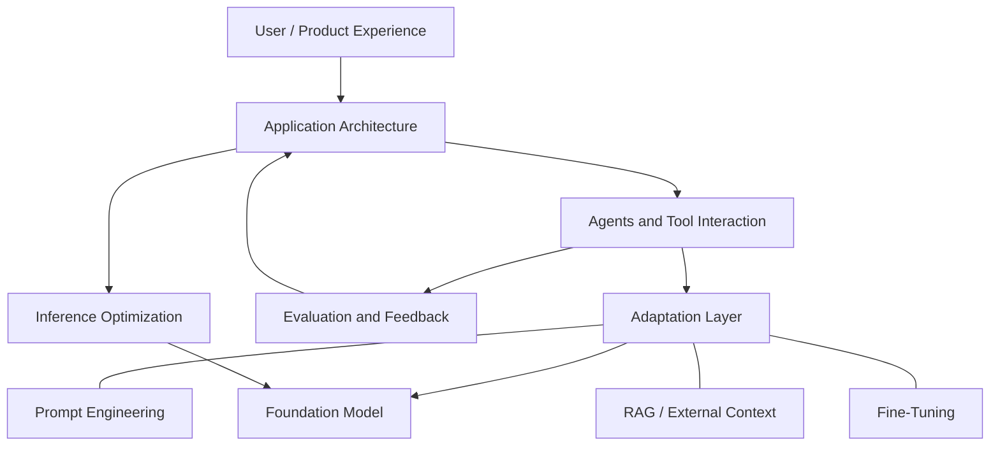
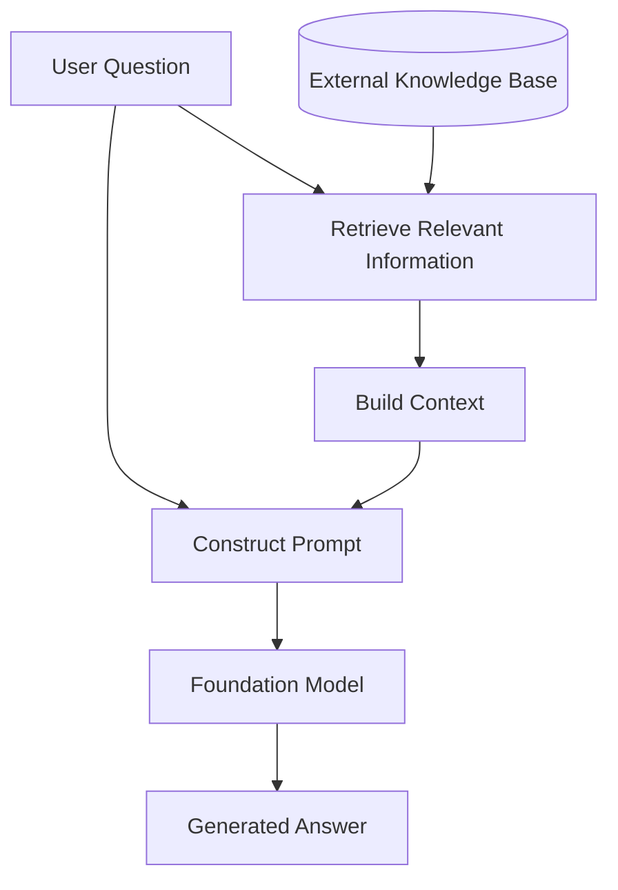
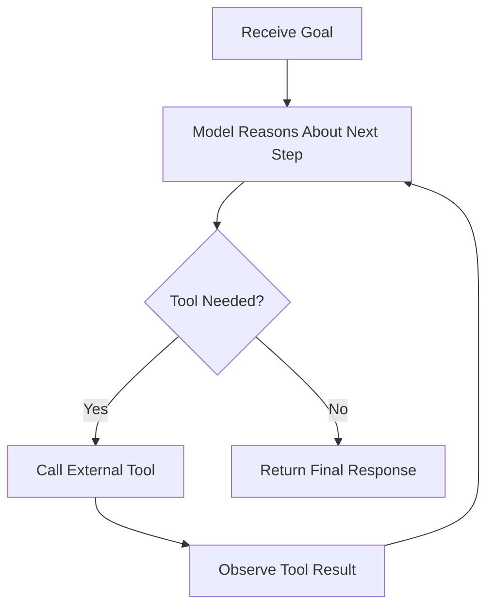
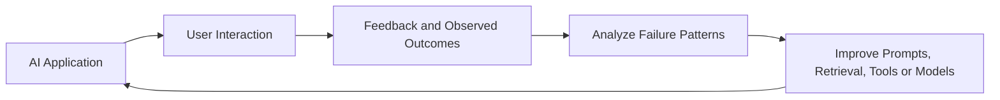

# AI Engineering: Foundations and the Modern AI Stack

## 1. What Is AI Engineering?

**AI Engineering** is the discipline of building software applications by leveraging existing, pre-trained **foundation models** rather than developing and training models from scratch.

The central idea is to take a powerful, general-purpose model and turn it into a useful, dependable product by combining it with software engineering techniques, data, tools, evaluation, and production infrastructure.

A useful mental model:

- **Model development** asks: How do we create and train a capable model?
- **AI engineering** asks: How do we use an available model to solve a real user problem reliably, safely, and efficiently?

AI engineering does not mean that machine learning knowledge is irrelevant. It means that application engineers often spend more of their effort adapting, integrating, evaluating, and operating models than inventing new model architectures or training foundation models.

## 2. The Shift in Paradigm

Traditional machine learning engineering and modern AI engineering have different centres of gravity.

| Traditional ML engineering | AI engineering |
|---|---|
| Collect and prepare task-specific datasets | Identify and select a suitable foundation model |
| Design or choose a model architecture | Adapt the behaviour of an existing model |
| Train models, often from scratch or through substantial retraining | Use prompting, retrieval, fine-tuning, and tools |
| Focus heavily on training pipelines and model metrics | Focus on product behaviour, evaluation, integration, and operations |
| Deliver a trained model for a defined task | Deliver a complete application built around model capabilities |

This is a shift from **building the intelligence itself** to **engineering a useful system around existing intelligence**.

It is not an absolute separation. AI products may still require data preparation, training, fine-tuning, and conventional ML components. The important change is where much of the engineering effort is spent.

## 3. The Modern AI Engineering Stack

An AI application is more than a call to a model API. It is a system made up of multiple layers that work together.

The diagram is a conceptual view, not a mandatory request sequence. Real systems may arrange these components differently, and not every application needs every technique.

### 3.1 Foundation Models

Foundation models are large, pre-trained models that serve as the core intelligence behind an AI application.

They are trained on broad datasets and can perform a range of tasks, such as:

- Understanding and generating natural language.
- Summarizing and transforming information.
- Answering questions.
- Generating or explaining code.
- Processing other modalities, depending on the model.

**Key idea:** A foundation model provides general-purpose capabilities. The application engineer builds the surrounding system that makes those capabilities useful for a particular product.

### 3.2 Adaptation Layer

A general-purpose model will not automatically behave exactly as a product requires. The adaptation layer contains techniques that guide or specialize the model for a particular use case.

The main techniques introduced in this chapter are:

1. Prompt engineering.
2. Retrieval-Augmented Generation (RAG).
3. Fine-tuning.
4. Agents and tool use.

These techniques solve different problems. They are not interchangeable, and a system may combine several of them.

### 3.3 Prompt Engineering

**Prompt engineering** is the practice of designing the instructions and input supplied to a model to guide its response.

A prompt can communicate:

- The task the model must perform.
- Relevant context.
- Constraints and rules.
- The expected output structure.
- Examples of desirable responses.

For example, instead of asking a model to simply summarize a document, an application might instruct it to produce a concise summary with sections for key decisions, risks, and action items.

**Key idea:** Prompt engineering changes the instructions given to the model. It does not, by itself, change the model's underlying weights.

### 3.4 Retrieval-Augmented Generation (RAG)

**Retrieval-Augmented Generation (RAG)** gives a model access to relevant external information while it generates an answer.

A foundation model may not know an organization's private, recent, or domain-specific information. RAG addresses this by retrieving relevant information from an external knowledge source and supplying it as context to the model.

A simplified flow:

**Key idea:** RAG supplies information at inference time. It does not require the model's weights to be retrained whenever the external knowledge changes.

### 3.5 Fine-Tuning

**Fine-tuning** is the process of further training a pre-trained model on a specialized dataset so that its learned behaviour becomes better suited to a particular task or domain.

It adjusts the model's weights using additional training examples.

Fine-tuning can be useful when an application needs a consistent specialized behaviour that is difficult to achieve through prompting alone.

**Key idea:** Unlike prompt engineering and RAG, fine-tuning changes model parameters.

### 3.6 Agents

An **AI agent** uses a model to decide what action to take and can interact with external tools or systems to accomplish a goal.

Tools might allow an agent to:

- Query a database.
- Call an API.
- Search a knowledge base.
- Execute an approved business operation.
- Delegate work to another component.

A simplified agent loop:

**Key idea:** A basic model interaction produces a response. An agentic system can use model decisions and tool results across multiple steps to make progress toward a goal.

Agents introduce additional engineering concerns, including tool permissions, execution limits, error handling, state management, and evaluation.

### 3.7 Evaluation

**Evaluation** is the process of testing and validating the quality of an AI system's outputs and behaviour.

This is especially important for generative systems because their outputs are often open-ended. There may be several acceptable answers rather than one exact expected result.

Evaluation can examine questions such as:

- Is the answer factually correct?
- Does it follow the requested instructions?
- Is it grounded in the supplied context?
- Does it use tools correctly?
- Is the output useful and relevant?
- Does the system behave consistently across representative cases?

One technique is **AI-as-a-judge**, where another model evaluates a generated response against defined criteria. This can help scale evaluation, but the judge itself can make mistakes or show bias. It should be calibrated and, where appropriate, supplemented with human review and deterministic checks.

**Key idea:** A successful demo is not proof that an AI application works reliably. Evaluation must be an ongoing engineering activity.

### 3.8 Inference Optimization

**Inference** is the process of running a trained model to generate an output from an input.

Inference optimization aims to make this process practical in production by managing:

- **Latency:** How long a user waits for a response.
- **Cost:** How much it costs to serve requests.
- **Throughput:** How many requests the system can handle.
- **Hardware efficiency:** How effectively available compute resources are used.

An AI application can produce excellent answers and still fail as a product if responses are too slow or expensive.

**Key idea:** Model quality is only one part of production readiness. The economics and performance of serving the model matter too.

### 3.9 Architecture and Feedback

The model is one component inside a larger software system. The application architecture must support the complete user experience and the operational requirements around it.

This includes designing for:

- Scalability and availability.
- Request orchestration and model integration.
- Data and state management.
- Observability and failure handling.
- Security and access control.
- Capturing user feedback and application outcomes.

Feedback can help identify poor responses, missing knowledge, confusing workflows, and recurring failure patterns. That information can then guide improvements to prompts, retrieval, tools, evaluation datasets, or model adaptation.

A simplified improvement loop:

**Key idea:** An AI application should not be treated as a one-time integration. It should improve through measured production behaviour and feedback.

## 4. Key Challenges in AI Engineering

### 4.1 Evaluation Is Difficult

Traditional software often has deterministic behaviour: given the same input and state, a function is expected to return the same output.

Generative AI is different. Responses can vary, and multiple responses may be valid. A simple exact-match test is often insufficient.

This makes it necessary to define quality criteria, build representative test sets, and combine automated evaluation with human judgement where needed.

### 4.2 Reliability

AI systems can produce incorrect or fabricated information, misunderstand instructions, or take an unsuitable action.

A particularly important failure mode is a **hallucination**: a model generates information that sounds plausible but is unsupported or incorrect.

In production, reliability requires more than hoping the model gives a good answer. The surrounding application must validate inputs and outputs, constrain actions, handle failures, and provide suitable fallbacks or human escalation.

### 4.3 Complexity

The AI engineering ecosystem contains a large and rapidly evolving set of:

- Foundation models and model providers.
- Adaptation techniques.
- Datasets and knowledge sources.
- Agent and orchestration patterns.
- Evaluation approaches.
- Serving infrastructure and optimization techniques.

The challenge is not to use every available technology. It is to select the simplest combination that meets the product's requirements and can be operated effectively.

## 5. The Goal of an AI Engineer

The AI engineer bridges the gap between the broad capabilities of foundation models and the specific needs of end users.

The role is to transform a powerful but general-purpose model into a product capability that is:

- Useful for a clearly defined problem.
- Reliable enough for its intended use.
- Integrated with the required data and tools.
- Scalable and observable.
- Efficient in terms of latency and cost.
- Continuously improved using evaluation and feedback.

In short:

> **The AI engineer does not merely connect an application to a model. The AI engineer engineers the complete system that makes the model useful in the real world.**

## 6. Chapter Summary

| Concept | What it contributes |
|---|---|
| Foundation Models | General-purpose pre-trained intelligence |
| Prompt Engineering | Guides model behaviour through instructions |
| RAG | Supplies relevant external information at inference time |
| Fine-Tuning | Specializes behaviour by updating model weights |
| Agents | Enable multi-step work through decisions and external tools |
| Evaluation | Measures output quality and system behaviour |
| Inference Optimization | Manages latency, cost, throughput, and compute efficiency |
| Architecture and Feedback | Makes the application scalable, observable, and improvable |

### The central mental model

AI engineering is the combination of **models + adaptation + application architecture + evaluation + production engineering**.

The model provides the capability. Engineering turns that capability into a dependable product.
